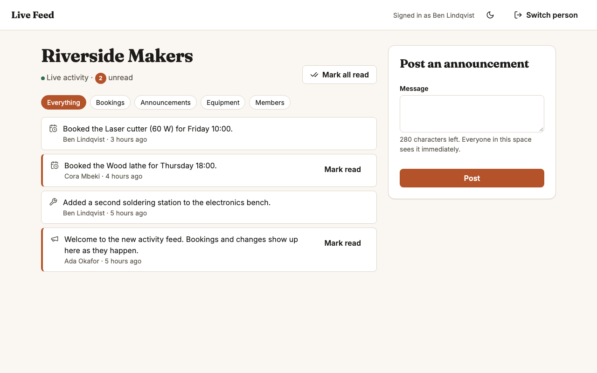
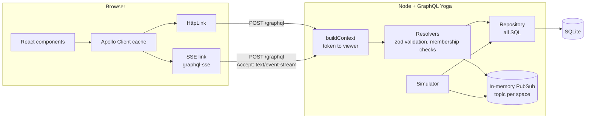

# Live Feed

A live activity feed for a network of makerspaces: members see bookings and announcements from their own space the moment they happen, and never from anyone else's. GraphQL subscriptions over Server-Sent Events, a TypeScript Node server, and a React client.

[](https://github.com/Nawfaldev19/graphql-sse-live-feed/actions/workflows/ci.yml)
[](LICENSE)



*The Riverside Makers feed, signed in as a staff member: unread items, kind filters, and the announcement form.*

## Why it exists

Live Feed serves a fictional group of makerspaces. Staff post announcements, members book equipment, and everyone wants to know what is happening in their space without refreshing. Real-time features are where authorization is easiest to get wrong: a push channel that skips the checks a normal query makes can leak one customer's events to another. This project shows a feed where the live path is as tightly scoped as the request path, and where paging, caching, and unread counts stay correct while new items keep arriving.

## Key features

- **Updates arrive without a refresh, and only for your space.** A subscription starts only after a membership check, and its PubSub topic is keyed by space, so a stream cannot carry another space's events. See the `Subscription` resolvers in [`resolvers.ts`](server/src/graphql/resolvers.ts) and the isolation tests in [`api.test.ts`](server/test/api.test.ts).
- **A live stream ends when access does.** Membership is checked again before every event and every 30 seconds, and the stream closes when the token expires, each time with a coded error the client acts on. See [`liveStream.ts`](server/src/graphql/liveStream.ts).
- **"Load older" never shows duplicates or skips items**, even while new items land at the top. Pages are keyed by activity id, not offset. See [`repository.ts`](server/src/feed/repository.ts) and [`cursor.ts`](server/src/feed/cursor.ts).
- **Marking an item read feels instant and ends up correct.** The client updates optimistically, then takes the server's unread count. A pushed item is written into every cached filter that would list it, so switching filters never shows a stale list. Live pushes and fetched pages merge through small pure helpers with de-duplication. See [`feedCache.ts`](client/src/lib/feedCache.ts) and [`FeedPage.tsx`](client/src/components/FeedPage.tsx).
- **Clients get errors they can act on.** Inputs are validated with zod, coded errors (`UNAUTHENTICATED`, `FORBIDDEN`, `NOT_FOUND`, `BAD_USER_INPUT`) survive Yoga's error masking, and tokens are HMAC-signed and compared in constant time. See [`context.ts`](server/src/graphql/context.ts), [`errors.ts`](server/src/graphql/errors.ts), and [`tokens.ts`](server/src/auth/tokens.ts).
- **A page of the feed costs a fixed number of queries.** Actors load with a join and read state for a whole page in one query. See `readIds` in [`repository.ts`](server/src/feed/repository.ts).
- **The feed moves on its own in the demo.** A simulator posts a plausible booking or equipment update every 6 seconds by default, so there is always something live to watch. See [`simulator.ts`](server/src/feed/simulator.ts).

## Quick start

Requirements: Node.js 20 or newer. Nothing else; the database is SQLite and is seeded on first start.

```bash
git clone https://github.com/Nawfaldev19/graphql-sse-live-feed.git
cd graphql-sse-live-feed
bin/dev
```

[`bin/dev`](bin/dev) installs packages into `server/node_modules` and `client/node_modules`, then starts the API at http://localhost:4000/graphql and the web app at http://localhost:5176.

Open http://localhost:5176 and pick a person. There are no passwords in demo mode ([ADR-008](docs/DECISIONS.md#adr-008-demo-identities-without-passwords)).

| Person | Spaces and roles |
|---|---|
| Ada Okafor | Owner at Riverside Makers, member at Foundry Lane Workshop |
| Ben Lindqvist | Staff at Riverside Makers |
| Cora Mbeki | Member at Riverside Makers |
| Theo Marsh | Owner at Foundry Lane Workshop |
| Priya Raman | Member at Foundry Lane Workshop |

**See the real-time path:** open two browser windows (one private), continue as Ben in one and Cora in the other, and post an announcement as Ben. It appears in Cora's feed without a refresh.

Turn the simulator off with `SIMULATOR=off`; every variable and its default is in [`.env.example`](.env.example). To reset the demo data, stop the servers and delete `server/data/`.

**With Docker instead:** `docker compose up --build`, then open http://localhost:5176.

## Architecture



- **Queries and mutations** go over a normal HTTP link; **subscriptions** are routed to an SSE link, so both carry the same bearer token in a standard header.
- **Resolvers** validate arguments with zod and check membership before reading, writing, or subscribing.
- **The repository** holds all SQL, which keeps paging, unread counts, and the N+1 fix in one reviewable file.
- **[`app.ts`](server/src/app.ts)** wires Yoga, PubSub, and services with no process-level concerns, so tests run the whole server in memory.

**Key trade-off:** Server-Sent Events instead of WebSockets, with an in-memory PubSub. SSE is plain HTTP that proxies handle like any request and that reconnects on its own, and the feed only needs server-to-client pushes ([ADR-001](docs/DECISIONS.md#adr-001-server-sent-events-instead-of-websockets)). The in-memory PubSub means no extra infrastructure, but events only reach clients on the same process, so the server cannot scale horizontally as is ([ADR-002](docs/DECISIONS.md#adr-002-in-memory-pubsub)).

The life of a live event, the data model, and performance notes: [docs/ARCHITECTURE.md](docs/ARCHITECTURE.md).

## Tech stack

| Choice | Why |
|---|---|
| Node.js 20 + TypeScript (strict) | One language across the stack; strict mode with unchecked index access. |
| GraphQL Yoga | Standards-compliant server with built-in subscriptions over Server-Sent Events and a typed PubSub. |
| Server-Sent Events (graphql-sse protocol) | Plain HTTP, works through most proxies, reconnects automatically; enough for server-to-client pushes. |
| better-sqlite3 | Synchronous, fast SQLite driver; zero setup for reviewers. |
| zod | Runtime validation for configuration and resolver arguments. |
| tsx | Runs TypeScript directly in development; the container runs the compiled JavaScript. |
| React 18 + Apollo Client 3 | A normalized cache that both pushes and fetched pages can update. |
| GraphQL Code Generator | Typed documents from the server's schema dump; CI fails on drift. |
| Vitest, Testing Library, Playwright | Unit, component, and multi-browser tests. |
| Prettier, ESLint | One formatting style (120 columns) checked in CI, plus strict type-aware lint rules. |

## Testing and quality

| Suite | Count | Line coverage |
|---|---|---|
| Server (Vitest): units, repository, API with real SSE streams in memory | 51 tests | 99% |
| Client (Vitest + Testing Library): cache helpers, components | 41 tests | 98% |
| End to end (Playwright): three simultaneous browser sessions | 3 tests | n/a |

The Playwright suite proves an announcement reaches its own space and nobody else ([`feed.spec.ts`](client/e2e/feed.spec.ts)). [CI](.github/workflows/ci.yml) runs a Prettier check, lint, type checking, tests with coverage, the build, and a schema-drift check for the server; codegen drift, the Prettier check, lint, type checking, tests, and the build for the client; then the end-to-end suite.

```bash
cd server
npm run format:check && npm run lint && npm run typecheck && npm run test:coverage && npm run build

cd ../client
npm run format:check && npm run lint && npm run typecheck && npm run test:coverage && npm run build
npx playwright install chromium   # once
npm run test:e2e                  # starts both apps on a fresh database, simulator off
```

Strategy, the isolation tests, and known gaps: [docs/TESTING.md](docs/TESTING.md).

## Decisions and further docs

- [Decision records](docs/DECISIONS.md): nine ADRs, from SSE and in-memory PubSub to keyset pagination and keeping every cached filter current
- [Architecture](docs/ARCHITECTURE.md): components, the life of a live event, data model, performance
- [Security](docs/SECURITY.md): threat model and mitigations
- [Testing](docs/TESTING.md): strategy, coverage, and known gaps
- [Scope](docs/PLAN.md): goal, scope, and the order I built it in
- [References](docs/REFERENCES.md): standards and sources
- [Changelog](CHANGELOG.md) and [third-party notices](THIRD_PARTY_NOTICES.md)

## Known limitations and next steps

- **Demo sign-in has no passwords.** Anyone can pick any identity. Token verification and authorization are real; only the identity check is skipped.
- **One server process.** Next: a Redis-backed PubSub, which is a change in `app.ts` with no resolver changes ([ADR-002](docs/DECISIONS.md#adr-002-in-memory-pubsub)).
- **Removal from a space is noticed by polling, not pushed.** An open stream sees it on the next event or within 30 seconds. Next: publish membership changes so affected streams close at once ([ADR-005](docs/DECISIONS.md#adr-005-access-re-checked-while-a-stream-is-open)).
- **Read state is one row per person per item.** Fine here; a large network would want a "last read" watermark ([ADR-004](docs/DECISIONS.md#adr-004-per-item-read-rows)).
- **Without `TOKEN_SECRET`, development generates a new secret on each start,** so restarting the server signs everyone out.
- **Reconnection and many-subscriber load are not tested automatically.** Next: a test that kills the server mid-stream, and a load test.
- **No push notifications or email.** Updates appear only while the page is open.

## Project status

Complete as a portfolio demo (v1.1.0, see the [changelog](CHANGELOG.md)). Not deployed; there is no hosted demo, so run it locally with the quick start above.

<details>
<summary>Recapturing the screenshot</summary>

Run `bin/dev`, open http://localhost:5176 in a 1280 x 800 window in light mode, click **Continue as Ben Lindqvist**, and save a screenshot as `docs/screenshot.png`.

</details>

## Author

Nawfal Imran · [GitHub](https://github.com/Nawfaldev19) · [LinkedIn](https://www.linkedin.com/in/nawfal-imran-886b13218)

## License

[MIT](LICENSE). Third-party licenses are listed in [THIRD_PARTY_NOTICES.md](THIRD_PARTY_NOTICES.md). All people, places, and data in the demo are fictional.
