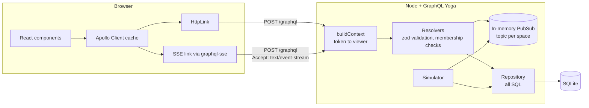
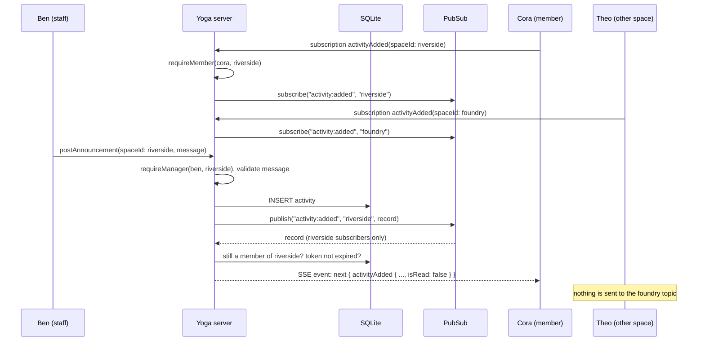
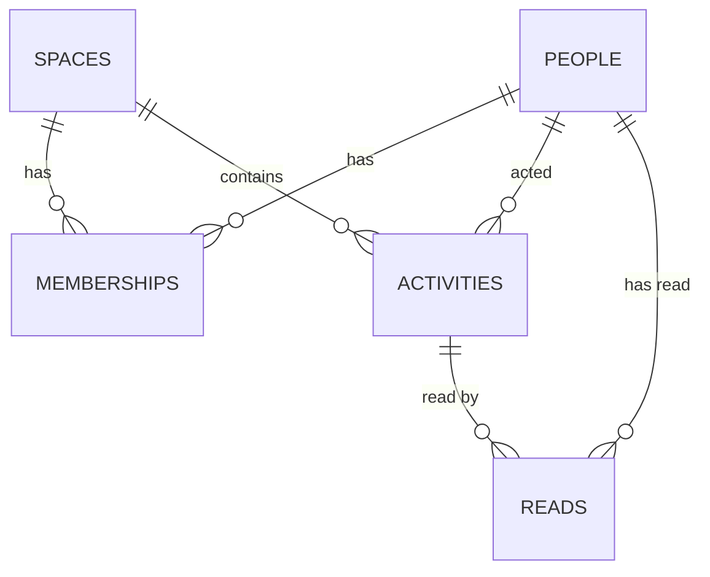

# Architecture

**Terms used here**

- **Space:** one makerspace. All activity belongs to exactly one space.
- **Activity:** something that happened in a space (a booking, an announcement, an equipment change, a new member).
- **Subscription:** a long-lived GraphQL operation; the server pushes a result each time a matching event happens.
- **SSE (Server-Sent Events):** a one-way HTTP stream from server to browser, part of the HTML standard.

## Components

| Folder | Responsibility |
|---|---|
| `server/src/config.ts` | Parse and validate environment variables; refuse to start in production without a secret. |
| `server/src/auth` | Issue and verify HMAC-signed tokens. |
| `server/src/db` | Schema and demo seed. |
| `server/src/feed` | Repository (all SQL), cursor encoding, simulator. |
| `server/src/graphql` | Type definitions, resolvers, context and guards, coded errors, and the guard that ends a live stream when access ends. |
| `server/src/app.ts` | Wires Yoga, PubSub, and services. No process-level concerns, so tests run it in memory. |
| `client/src/lib` | Apollo client with the SSE link, session, cache helpers, time formatting. |
| `client/src/components` | Welcome, workspace shell, feed, items, announcement form. |

## Life of a live event

The `resolve` step runs once per subscriber, so `isRead` is computed for each viewer (own activity counts as read).

Before each event is sent, the stream guard checks that the viewer is still a member and the token has not expired. Timers repeat the membership check every 30 seconds and fire at the token's expiry, so a quiet stream is closed as well. A closed stream sends one payload with a coded error and then `complete`; the client signs out on `UNAUTHENTICATED` and shows "Live updates stopped" otherwise ([ADR-005](DECISIONS.md#adr-005-access-re-checked-while-a-stream-is-open)).

On the client, the pushed item is written with `prependLive` into every cached filter that would list it: "Everything" and the item's own kind ([ADR-009](DECISIONS.md#adr-009-live-items-update-every-cached-filter)). `prependLive` ignores an item that is already present (a refetch can race the push). The unread count is one field per space, shared by all filters, and is incremented once. If the reader has scrolled down, a "N new" button appears and the count is announced in a polite live region.

## Data model

- `activities.id` is an auto-increment integer assigned at insert, so ordering by `id` is the same as ordering by creation time. That makes it a stable keyset for pagination (see [ADR-003](DECISIONS.md#adr-003-keyset-pagination-on-the-activity-id)).
- `reads` stores one row per person per activity read. "Mark all read" inserts the missing rows in one statement.
- Check constraints enforce valid kinds, roles, and summary length at the database level.

## Tenancy and authorization

Every repository method that touches activity takes a `spaceId` and filters by it in SQL, so a caller cannot forget the tenant filter. Whether the viewer may act in that space is decided once per resolver by `requireMember` or `requireManager` in [`context.ts`](../server/src/graphql/context.ts). A space the viewer is not in returns `NOT_FOUND`, the same as a space that does not exist.

`markRead` joins the requested ids against the space, so ids from another space are silently ignored rather than marked.

## Performance

| Concern | Approach |
|---|---|
| N+1 on actors | The page query joins `people`; no per-item lookups. |
| N+1 on read state | `readIds` checks a whole page of ids in one query. |
| Pagination cost | Keyset (`WHERE id < ?`) with indexes on `(space_id, id DESC)` and `(space_id, kind, id DESC)`; cost does not grow with page depth. |
| Page size | Capped at 50; `markRead` accepts at most 100 ids. |
| Push fan-out | One PubSub topic per space; publishing does work proportional to that space's subscribers only. |
| Client re-renders | Relative times refresh every 30 seconds, not every second. |

## Logging

Every log line is one JSON object (`time`, `level`, `event`, plus fields). Each GraphQL operation logs its name and duration; sign-ins and announcements log their ids. Tests run with `LOG_LEVEL=silent`.

## Design system

The client uses the same design tokens as the other makerspace demos in this portfolio ([`tokens.css`](../client/src/styles/tokens.css)): Fraunces for headings, Inter for body text, JetBrains Mono for code; a warm neutral palette with a copper accent; light and dark themes; and motion that turns off under `prefers-reduced-motion`.
